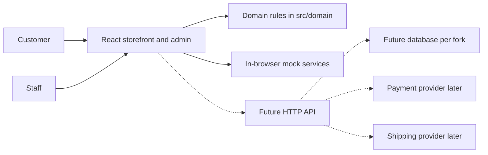

# A0 — Agent 01 input audit

| Field | Value |
|---|---|
| Milestone | A0 Intake and design handoff audit |
| Date | 21 Oct 2026 |
| Status | Approved 21 Oct 2026. Owner: "I approve, Go ahead and continue" |
| Package | `ecommerce-starter-handoff-agent02/` (Agent 01, M0–M8) |
| Instruction followed | Root `Prompt.md` §27 and §31. A0 only |

This audit records what is in the handoff, which approved rules already bind later milestones, and which questions are still open. It does not select a frontend framework, database, ORM, payment provider, or shipping provider, and it does not design tables or APIs.

## 1. Review method

Reviewed on 21 Oct 2026 from local files:

- Package integrity against `MANIFEST.sha256` (190 of 190 files match; the manifest file itself is the only extra file, which is expected).
- Both copies of the 20 documents (`docs/` and `code/ecommerce-starter/docs/`) have identical SHA-256 hashes.
- `design/claude-design-canvas/canvas.json`: canvas title "Agent 01 — E-Commerce Starter", 7 pages (M0–M6), 76 boards. Board titles were listed from that file.
- Spot-read of board source, not a browser render: `X12-Wireframes.dc.html` (A17 access matrix and settings frames) and `W12-Alternatives.dc.html` (L1–L4 decision callouts).
- Domain modules, `src/services/contracts.ts`, `src/App.tsx` routes, `src/domain/rbac.ts`, `src/domain/analytics.ts`, `src/domain/orders.ts`, `src/domain/search.ts`, and `package.json`.
- `evidence/final-test-log.txt` (21 Oct 2026, 07:55 WIB).

Not reviewed, and therefore not treated as seen:

- The live canvas at `https://claude.ai/artifact/Y5sZPpUGrBHZ4LjZwgaEGD`. Access was not available from this session. Local `.dc.html` exports and `canvas.json` are the design record used here.
- Pixel-level review of the 76 boards and of the 8 screenshots in `evidence/screenshots/`. QA_REPORT K-6 already says Agent 01 did not screenshot-verify M2–M6 board rendering.
- A fresh Playwright run. See §8 for the local Node version limit.

## 2. Artifact inventory

| Component | What is on disk | Status | How later milestones reuse it |
|---|---|---|---|
| Decisions | `docs/ASSUMPTIONS_AND_DECISIONS.md` (D1–D16, I1–I9, L1–L4, C1–C11, P1–P12, R1–R15) | Approved 20–21 Oct 2026, with items HANDOFF §4 still owner-reversible | Source of truth when it conflicts with earlier prompt suggestions |
| Handoff | `docs/HANDOFF_AGENT02.md` | Approved with M8 | Architecture of the prototype and the ten production steps |
| Scope and brief | `DESIGN_SCOPE.md`, `PROJECT_BRIEF.md` | M0 approved | Essential / supporting / future classification |
| IA and flows | `SITEMAP.md` (43 storefront + 23 admin), `USER_FLOWS.md` (J1–J7), `SCREEN_INVENTORY.md`, `WIREFRAME_SPEC.md` | M1–M2 approved | Screen and state inventory for requirements |
| Design system | `DESIGN_SYSTEM.md`, `COMPONENT_INVENTORY.md`, `RESPONSIVE_RULES.md`, `design/tokens/brand-a.json`, `brand-b.json` | M3 approved. File banners still say "awaiting approval"; see OD-04 | Tokens and component contract. Do not redesign |
| Storefront hi-fi | Canvas page M4, boards H01–H21 plus overview and ProductArt | M4 approved | Visual and interaction reference |
| Admin and CMS | Canvas page M5, boards X01–X12 | M5 approved. C7–C9 recorded as owner-reversible | Admin behaviour and the A17 matrix |
| Clickable prototype | Canvas page M6, P01–P06 | M6 approved. P10 and P12 remain open in HANDOFF §4 | Scenario reference, not production logic |
| React prototype | `code/ecommerce-starter/` v0.8.0. Vite 5.4.10, React 18.3.1, TypeScript 5.6.3, Tailwind 3.4.14, React Router 6.30.6, Zustand 4.5.5 | M7–M8 approved | UI to preserve. `src/domain` is the rule reference. `src/services/contracts.ts` is the seam |
| API and data drafts | `API_CONTRACTS.md`, `DATA_MODEL.md` | Drafts for the next agent, derived from the prototype | Starting point for A3 and A4, not a finished contract |
| Security, QA, metrics, fixtures | `SECURITY_CHECKLIST.md`, `QA_REPORT.md`, `ANALYTICS_METRICS.md`, `MOCK_DATA_CONTRACT.md`, `TRACEABILITY.md` | M8 approved, with known issues K-1…K-9 | Baseline and seed contract (W00) |
| Supporting docs | `PROTOTYPE_GUIDE.md`, `USABILITY_TEST_PLAN.md` | M6 content approved; banners still say pending. Usability thresholds unset | Test-scenario input. Thresholds stay unset |
| Design exports | 76 `.dc.html` files + `canvas.json` | Present and checksum-matched | Local design record |
| Evidence | `final-test-log.txt` + 8 PNGs | Log read. PNGs not visually inspected | Claimed result: typecheck clean, 46/46 unit, 69+75+72 e2e, release gate refuses mock services, 2 moderate `npm audit` findings |
| Alternate mandate | `AGENT02_PROMPT.md` inside the package | Not an owner decision over `Prompt.md` | Recorded as OD-01. It asks for implementation milestones B0–B9 |

`src/` has 47 files: pure domain (16), service contracts and in-browser mocks (4), Zustand stores (3), pages (11), admin (2), shared components (5), brand config (1), app shell and styles (5).

## 3. Approved requirements summary

The product is a reusable B2C storefront template. Each client gets its own fork and its own VPS. It is not a multi-tenant SaaS product. Market rules already approved: Indonesia only, Bahasa Indonesia for customer and admin copy, English for code and for admin URL paths, integer Rupiah, prices include PPN with no separate tax line, timezone Asia/Jakarta.

Customers may browse and hold a cart without an account. Checkout requires sign-in. There is no guest checkout. A guest cart merges into the account cart on sign-in, quantities add per SKU, and the merge is capped by stock with the caps reported. Wishlist requires sign-in. Tracking is inside the account.

Commerce rules already approved and implemented as pure functions under `src/domain`:

- Money is integer Rupiah. A percentage discount is floored per unit to Rp1. A line is unit price times quantity. Display format is `Rp1.250.000`.
- One price promotion per line. The lowest price wins. An equal price keeps the promotion that is already active (P12, still reversible). Per order, at most one order voucher and one shipping voucher. Order vouchers skip flash-sale items unless the voucher allows them. Application order: product promotion, then order voucher, then shipping.
- Stock is reserved when the order is created, including gift units, after a fresh stock and price check on "Buat pesanan". QRIS and e-wallet expire in 15 minutes. Virtual account expires in 24 hours. Expiry, failure, and cancellation release the reservation. Payment commits it.
- Order numbers are `ORD-YYMMDD-NNNN` in WIB, at most 9999 per day. Payment status and fulfilment status are separate. "Diterima" is set from a courier event. A shipment with no courier event for more than 72 hours is flagged "update terlambat"; that flag is not its own status.
- Refunds are recorded by Owner or Admin only, for an amount no greater than the remainder. A refund after shipment is out of scope until a returns flow is approved (P10).
- Revenue is paid totals minus refunds. Paid amounts count on the payment day. Refunds count on the refund day. Both use WIB dates. The W00 seed for 14–20 Oct 2026 is net Rp2.097.000, 8 paid orders, AOV Rp262.125. Payment completion is 88,9% (8 paid / 9 paid-or-expired). Conversion on the mock session count is 0,65% (8 / 1.240). See OD-06.
- The reference checkout ORD-261020-0010 totals Rp587.250 (two B01-2M-BLK, one B03, KABEL10 capped at Rp30.000, Kurir A Rp18.000, GRATISONGKIR). HEMAT50 is rejected because the eligible subtotal is Rp318.000, under Rp500.000.
- Staff roles are Owner, Admin, Operasional, Marketing, and CS. The drawn matrix is on board X12 (A17). Customer sign-in locks for 15 minutes after 5 failures and uses a generic error. Staff sign-in requires TOTP, has the same lock, and has no self-service reset. Contact reveal needs a reason from a fixed list of three, lasts 60 seconds, and is logged. Consent is append-only and checked at send time: transactional email always, transactional WhatsApp only with `waOrderInfo`, marketing email only with `emailPromo`, no WhatsApp marketing.

Two showcase brands are configuration, not tenants: Halimun (cosmetics, editorial, top-bar filters) and Sambung (computer accessories, dense catalog, sidebar filters). Both names are unscreened working names (D15).

Essential scope is in `DESIGN_SCOPE.md`. Future, and therefore out of the first implementation slice unless the owner adds it: B2B price lists, real review submission, loyalty, gift cards, subscriptions, multi-language, multi-currency, live chat, multi-warehouse, PWA offline, phone OTP, and public tracking by order number. B2B is an inquiry form only.

## 4. Initial system boundaries

What exists today is the solid path: the browser holds the UI, the domain functions, and the mock services. Sessions are memory only. Reload resets the demo (R2). Payment outcomes come from a labelled simulator. Shipping quotes ignore the destination (P4) and use four fictional couriers.

What a later milestone may specify, and what A0 does not design, is the dashed path: one NestJS application per fork, one database per fork, provider adapters, and signed webhooks. No shared tenant database and no tenant id on every entity.

The prototype is not a security boundary. SECURITY_CHECKLIST marks server controls A-1, A-3, A-4, A-5, A-7, A-8, Z-1, P-1 through P-5, D-3, and W-1 as still to build. Items marked "Done (proto)" still have to be reimplemented on the server. `npm run build:client` is specified to fail while demo tools are on or any `src/services/mock` import remains (R12). That gate stays.

### Routes the prototype actually runs

Storefront routes in `src/App.tsx`: `/`, `/kategori/:slug`, `/produk/:slug`, `/cari`, `/bandingkan`, `/keranjang`, `/checkout/:step`, `/pembayaran/:nomor`, `/masuk`, and account routes `/akun`, `/akun/pesanan`, `/akun/pesanan/:nomor`, `/akun/wishlist`, `/akun/alamat`, `/akun/preferensi`.

Admin routes: `/admin/login`, `/admin`, `/admin/orders`, `/admin/orders/:nomor`, `/admin/promotions`, `/admin/audit-log`.

Designed screens with no route yet, matching QA_REPORT K-4: registration, password recovery, profile edit, address create/edit as an interactive form, about, contact, bulk inquiry, FAQ, blog, campaign, collection, shipping info, legal pages, and admin product edit, inventory, content, customers, the standalone analytics screen, reports, users, and store/shipping/payment/notification settings. High-fidelity or wireframe boards for those screens exist (H08, H14–H19, X04–X06, X09–X12). They are requirements input, not working software.

Routing today is `HashRouter`, or `MemoryRouter` in the artifact build (R1). Crawlable URLs need `BrowserRouter` plus server rewrites. That change is an A2 topic, together with whether static prerendering or a different React framework is required for SEO. The approved visual design does not change because of that choice.

## 5. Assumptions carried forward

From `ASSUMPTIONS_AND_DECISIONS.md`, working assumptions, not new decisions:

1. No guest checkout.
2. One store, one stock location, and one shipping origin per fork.
3. No numeric KPI targets and no binding SLOs. Measurement definitions only.
4. Every person, address, courier (Kurir A–D), bank (Bank A–C), and payment reference in W00 is fictional.
5. Imagery is placeholder or original illustration.
6. The prototype does not persist personal data in browser storage.
7. Analytics events must not contain personal data.
8. Delivered status comes only from a courier event.
9. Layout validation widths are 360, 390, 768, 1280, and 1440 px.
10. Brand A stock other than the shared A04 / bundle pool is not defined in W00. The prototype cap of 10 per line is a demo limit, not a business rule (P6).

M7 approval was the owner's reply "Continue", which Agent 01 recorded as approval and flagged. This audit keeps that record (OD-05).

## 6. Conflicts and gaps found

Full entries, proposed defaults, and risk are in [OPEN_DECISIONS.md](OPEN_DECISIONS.md). The ones that change how the program is run:

| ID | Topic | Proposed handling |
|---|---|---|
| OD-01 | `Prompt.md` specifies only (milestones A0–A7, Agent 03 implements). `AGENT02_PROMPT.md` tells Agent 02 to build the backend (milestones B0–B9) | Accept with A0: follow `Prompt.md`. Do not start B0 |
| OD-02 | Prompt role names differ from approved D10 / X12 | Approved roles win. No new decision |
| OD-03 | Prompt still treats promotion stacking as undecided; D3 already decides it | D3 wins. P12 and refund allocation stay open |
| OD-06 | Handoff text writes the W00 tuple as `… / 88,9%`, which is payment completion, while conversion is 0,65% | Keep both figures with their metric IDs |
| OD-07 | X12 grants product, inventory, content, and shipping-settings rights that `rbac.ts` does not encode | A1 expands the permission catalogue from the board |
| OD-08 | D13 address fields are richer than `Address` in `types.ts` and `DATA_MODEL.md` | A1 states D13 as the requirement |
| OD-09 | User-flow search specifies typo tolerance and ranking; `search.ts` is substring match (P8) | P8 is the prototype. The flow is the production target, to be specified in A1 |

Also recorded there: stale "awaiting approval" banners, the M7 "Continue" flag, path mismatches between SITEMAP and X12, no fulfilment status for "Gagal kirim", missing admin and content routes (K-4), and the open owner items already listed in HANDOFF §4 (trademark, repeat-buyer window, lockout, returns, tie-break, reveal duration, legal copy, font hosting, usability thresholds).

`TRACEABILITY.md` cites an admin e2e check of Rp1.880.000. That figure is the dashboard after the test records a full refund of ORD-261019-0007 (Rp217.000): 2.097.000 − 217.000 = 1.880.000. The seed net remains Rp2.097.000. The log line `desktop dashboard Rp2.097.000` and the later `D12 net after refund Rp1.880.000` are both present. This is not a second revenue definition.

## 7. Discovery plan for A1–A7

Each milestone stops for APPROVE, REVISE, or HOLD. ADRs stay Proposed until the owner accepts them. Estimates in A6 will be ranges, not dates.

| Milestone | What it will produce from this audit | What it will not do |
|---|---|---|
| A1 Requirements | PRD, functional requirements, non-functional requirements, use cases, business rules, and a traceability matrix. Priority P0 / P1 / P2. Separate rows for "simulated in the prototype", "required in the first implementation", and "later production integration". Close OD-06, OD-07, OD-08, OD-09 in the requirement text. Carry HANDOFF §4 items as explicit open rules with the prototype default | Invent KPI targets. Mark unapproved rules as final. Redesign screens |
| A2 Architecture decisions | ADRs for frontend rendering (keep the Vite UI; evaluate React Router 7 plus prerender versus Next.js for SEO), NestJS modular monolith, PostgreSQL, ORM, search evolution, cache and jobs, deployment shape. Diagrams of containers and modules | Mark any ADR Accepted. Introduce microservices or a tenant platform |
| A3 Domain and data | Bounded contexts, logical ERD, data dictionary, inventory invariants, checkout transaction, and separate payment / fulfilment / shipment state machines. Address model aligned to D13. Permission list aligned to X12 | SQL migrations or a running database |
| A4 APIs and integrations | OpenAPI from `API_CONTRACTS.md` plus the admin catalogue, inventory, CMS, and account endpoints the prototype does not call yet. Payment and shipping adapter contracts and a capability matrix. Webhook, idempotency, and reconciliation flows. No invented provider fields | Sandbox calls, provider accounts, or a claim that a gateway is integrated |
| A5 Non-functional and infrastructure | Proposed performance targets with a validation method, security baseline mapped to SECURITY_CHECKLIST, privacy notes for UU PDP with items flagged for legal review, SEO approach consistent with the A2 frontend ADR, Tencent Cloud VPS topology, backups, monitoring | Binding SLOs, legal certification, or any infrastructure change |
| A6 Test and implementation planning | Test strategy including the 15 critical cases in `Prompt.md` §22, plus the W00 numeric checks (Rp587.250 and the M1–M6 seed). Work breakdown for Agent 03 with acceptance criteria on every package | Implementation |
| A7 Handoff | Cross-document consistency pass and the Agent 03 handoff | Production go-live |

Dependency order is A1 → A2 and A1 → A3, then A4 after A2 and A3, then A5 and A6, then A7. A2 and A3 can be reviewed as separate approvals; A3 should not freeze column types that an A2 ORM ADR has not yet framed, so A2 is reviewed first.

## 8. Independent prototype check

`evidence/final-test-log.txt` reports, on Node 22: typecheck clean, 46/46 unit tests, 69/69 storefront, 75/75 admin, 72/72 QA, release gate refusing mock services, and 2 moderate audit findings.

This workstation has one Node binary, v16.20.2 (`C:\Program Files\nodejs\node.exe`). On 21 Oct 2026:

| Check | Result |
|---|---|
| `npm ci` | Completed. `EBADENGINE` warnings: packages such as chai declare Node ≥ 18 |
| `npx tsc -b --noEmit` | Exit 0 |
| `npm test` (Vitest 2.1.4) | 9 passed, 16 failed, and 2 files failed to load (`admin.test.ts`, `batch2.test.ts`). Every failure is `ReferenceError: structuredClone is not defined` |

`structuredClone` has existed since Node 17. The failures are the runtime, not a disagreement with the domain rules. The Node 22 log remains the evidence for 46/46. Playwright was not re-run. A later toolchain note for A6: pin a Node version that provides `structuredClone` (the M8 log used Node 22).

`node_modules` from `npm ci` is outside the manifest (the prototype `.gitignore` excludes it). No file listed in `MANIFEST.sha256` was modified.

## 9. Acceptance checklist

- [ ] Package integrity result is accepted (190/190, docs copies identical).
- [ ] The inventory in §2 matches what the owner believes was handed off.
- [ ] Approved decisions override conflicting suggestions in `Prompt.md` (OD-02, OD-03).
- [ ] The active mandate is specification milestones A0–A7, with implementation left to Agent 03 (OD-01).
- [ ] W00 figures are accepted as M1 Rp2.097.000, M2 8, M3 Rp262.125, M4 0,65% on 1.240 mock sessions, M6 88,9% (OD-06).
- [ ] Items in HANDOFF §4 stay open and are not treated as closed by this audit.
- [ ] No framework, database, ORM, or provider is selected in A0.
- [ ] A1 is allowed to start only after this milestone is approved.
